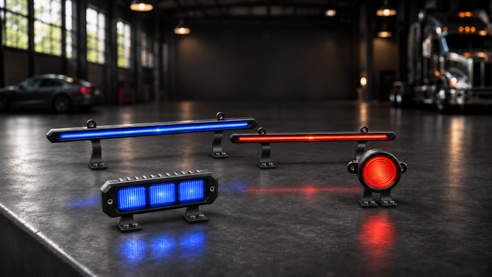
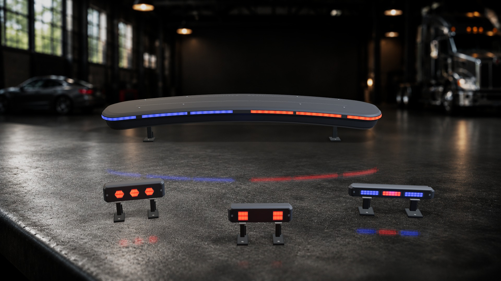
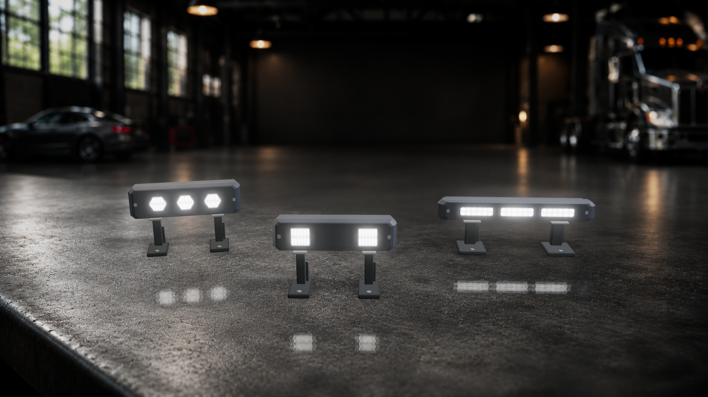
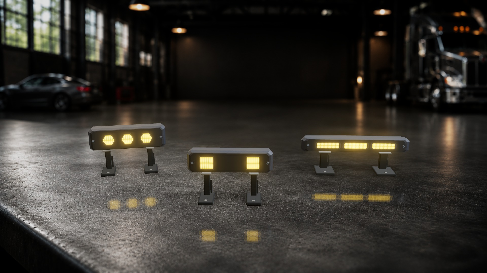
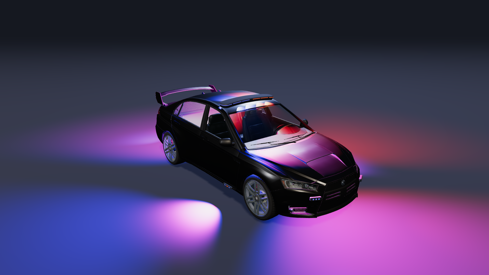
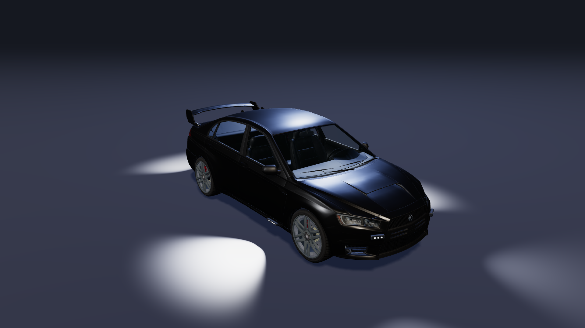
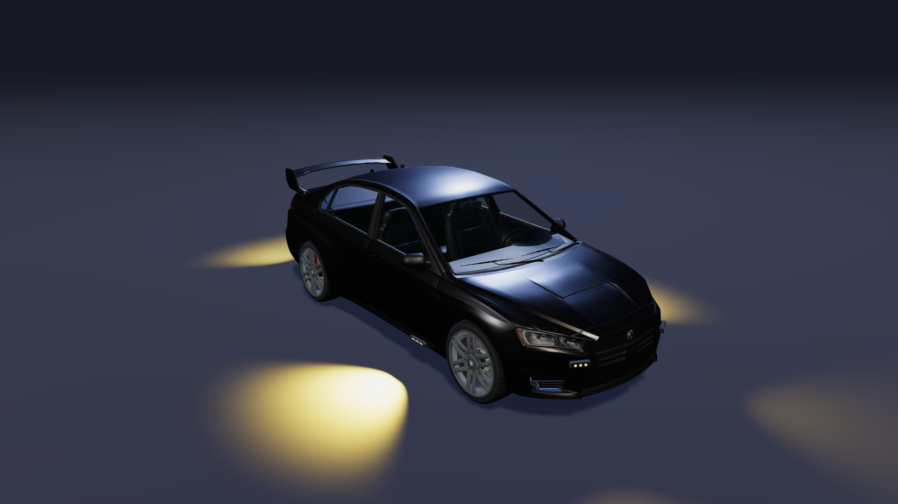
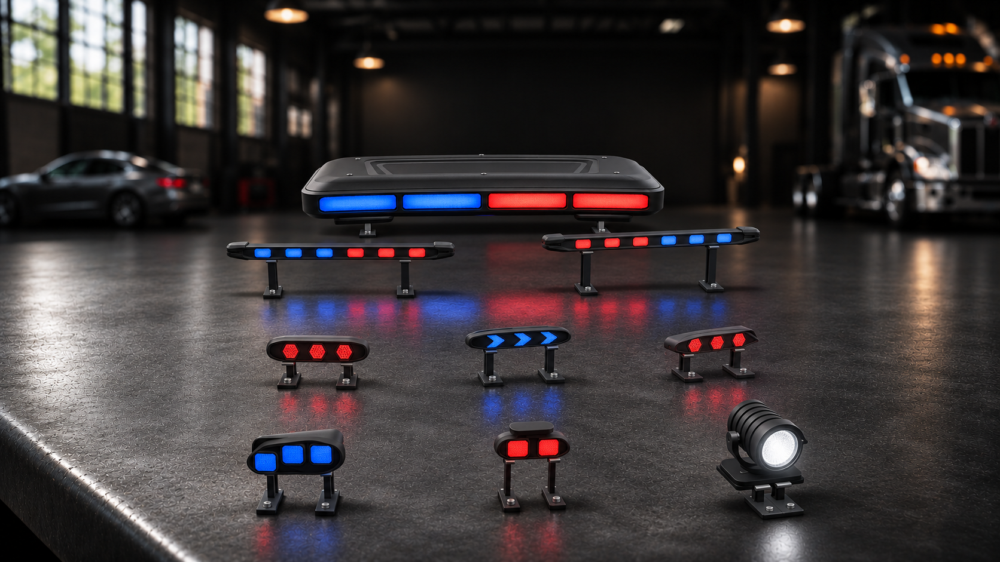
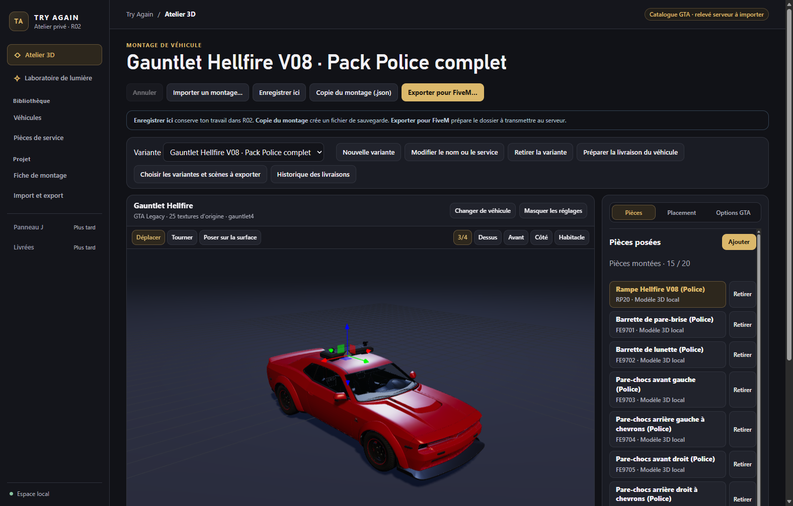

# Catalogue des packs

Les trois ensembles de jeu ci-dessous sont pris en charge par le [dépôt CELK 0.3.2](versions/0.3.2/INSTALLATION.md). La 0.3.2 réutilise les ZIP exacts de la 0.3.1. [Empreintes](versions/0.3.2/SHA256SUMS.txt)

## Phantom Grand Format · 0.1.0

Quatre types d’optiques conçues par **Spino**, leurs lentilles rouges et bleues et un montage Police à 14 accessoires pour le Phantom GTA d’origine. Les positions couvrent la calandre, le pare-chocs, le pare-brise et les marchepieds. La livraison de modèle inclut cinq scènes. Le véhicule est fourni par GTA V.

*Visuel de présentation des optiques conçues par Spino. La texture et la teinte du métal illustrent la scène.*

L’ensemble `060a37bf` réunit le montage Police et la ressource `celk_pack_phantom` **0.1.0**. En solo, le passage entre deux scènes, l’extinction et la reprise du montage après recréation du véhicule ont été vérifiés.

[Télécharger l’ensemble Phantom](https://raw.githubusercontent.com/MrSpinoQc/custom-emergency-light-kits/2b67b717dab6486deb1744418c48c2448d11d50b/telechargements/ensemble-phantom-060a37bf.zip) · [Installation par dépôt](versions/0.3.2/INSTALLATION.md)

## Airport Bus Police V05

Le montage pour `airbus` comporte **20 pièces** et **trois scènes**. La séance solo a vérifié les trois scènes, dont **Tour du périmètre**, les quatre modules blancs PR06 accessibles dans **J** et le retour de la souris après fermeture du menu. L’ensemble `78be8891` fournit `celk_pack_airport_bus_v05` **0.5.0**.

[Télécharger l’ensemble Airport Bus](https://raw.githubusercontent.com/MrSpinoQc/custom-emergency-light-kits/2b67b717dab6486deb1744418c48c2448d11d50b/telechargements/ensemble-airbus-78be8891.zip) · [Installation par dépôt](versions/0.3.2/INSTALLATION.md)

## Kuruma V05 · trois variantes

L’ensemble `41340f59` fournit `celk_pack_kuruma_r03` **0.5.0-refonte.2**.

| Variante | Pièces | Scènes |
| --- | ---: | ---: |
| Police v2 · rampe de toit rouge et bleue | 7 | 3 |
| Ambulance blanche | 6 | 2 |
| Mécano jaune | 6 | 2 |

Le contrôle solo a vérifié la disparition des pièces et des effets lors des changements de variante, la reprise du choix Mécano avec les feux éteints et le retour de la rampe en Police.

[Télécharger l’ensemble Kuruma](https://raw.githubusercontent.com/MrSpinoQc/custom-emergency-light-kits/2b67b717dab6486deb1744418c48c2448d11d50b/telechargements/ensemble-kuruma-41340f59.zip) · [Installation par dépôt](versions/0.3.2/INSTALLATION.md)

### Galerie Kuruma

Rendu Studio V05 des accessoires conçus par **Spino**. La rampe et les trois familles de modules couvrent les sept poses Police. Chaque paire gauche-droite est représentée par un exemplaire. Les supports noirs servent à la présentation sur l’établi.

Optiques Ambulance blanche et Mécano jaune

**Ambulance blanche** · Trois familles de modules en blanc, avec le toit dégagé sur le véhicule.

**Mécano jaune** · Trois familles de modules en jaune, avec le toit dégagé sur le véhicule.

#### Vues montées dans l’Atelier R03

Aperçus de la Kuruma civile de GTA V avec les poses de l’ensemble `41340f59`, utilisé en CELK 0.3.1 et 0.3.2. Les cinq angles par variante montrent la carrosserie et les emplacements. L’éclairage de l’aperçu dépend de la phase indiquée.

Police v2 · cinq vues

*Double alternance gauche–droite à 3,040 s.*

[Avant](images/kuruma/vehicule/police-avant.png) · [Arrière](images/kuruma/vehicule/police-arriere.png) · [Profil gauche](images/kuruma/vehicule/police-profil-gauche.png) · [Dessus](images/kuruma/vehicule/police-dessus.png)

Ambulance blanche · cinq vues

*Arrivée · blanc alterné à 3,000 s.*

[Avant](images/kuruma/vehicule/ambulance-avant.png) · [Arrière](images/kuruma/vehicule/ambulance-arriere.png) · [Profil gauche](images/kuruma/vehicule/ambulance-profil-gauche.png) · [Dessus](images/kuruma/vehicule/ambulance-dessus.png)

Mécano jaune · cinq vues

*Intervention · jaune en croix à 3,120 s.*

[Avant](images/kuruma/vehicule/mecano-avant.png) · [Arrière](images/kuruma/vehicule/mecano-arriere.png) · [Profil gauche](images/kuruma/vehicule/mecano-profil-gauche.png) · [Dessus](images/kuruma/vehicule/mecano-dessus.png)

[Provenance et crédits des visuels](images/kuruma/PROVENANCE.md)

## Hellfire Police V08

**Parcours historique.** Les résultats ci-dessous accompagnent la version **0.2.0-rc.2-hellfire.5**.

Un montage Police à **15 pièces** pour le Gauntlet Hellfire de GTA V, conçu par **Spino**. La livraison regroupe la rampe V08, les feux V07 et les deux projecteurs V06. La scène **Hellfire complète · Double alternance** comporte **50 pistes**.

| Ressource requise | Version |
| --- | --- |
| `celk_pack_hellfire_v06` | **0.6.0** |
| `celk_pack_hellfire_v07` | **0.7.0** |
| `celk_pack_hellfire_v08` | **0.8.0** |
| `celk_runtime` | **0.2.0-rc.2-hellfire.5** |

Les trois ressources du pack démarrent avant le runtime. Le ZIP contient l’ensemble installable de 155 fichiers, ses manifestes, la sélection et le montage. Les actifs incluent **142 YDR et 3 YTYP** d’accessoires, avec les textures intégrées. Le Gauntlet Hellfire est le modèle GTA `gauntlet4`.

### Composition du montage Hellfire

La livraison installe **15 pièces**, réparties en **neuf familles**. Le visuel de présentation montre un exemplaire de chaque famille.

| Pièce | Exemplaires dans le montage |
| --- | --- |
| Rampe V08 | 1 |
| Barrette de pare-brise | 1 |
| Barrette de lunette arrière | 1 |
| Modules de pare-chocs avant | 2 |
| Chevrons de pare-chocs arrière | 2 |
| Feux de flanc avant | 2 |
| Feux de flanc arrière | 2 |
| Modules sous les rétroviseurs | 2 |
| Projecteurs orientables V06 | 2 |

**Visuel** · rendu des modèles 3D de production de Spino avec finition d’ambiance générative. [Provenance du visuel](images/hellfire-police-v08-provenance.md)

**Qualification** · 5/5 contrôles GTA solo sur l’export distribué et CELK 0.2.0-rc.2-hellfire.5. Pose, diffusion et extinction Q, deux têtes J, portes, mouvement et reprise du montage ont été contrôlés. Le multijoueur reste non testé. [Essais et limites](versions/0.2.0-rc.2-hellfire.5/README.md#essais-et-limites)

[Préversion et téléchargements historiques](https://github.com/MrSpinoQc/custom-emergency-light-kits/releases/tag/v0.2.0-rc.2-hellfire.5) · [Installation historique](versions/0.2.0-rc.2-hellfire.5/INSTALLATION.md) · [Empreintes](versions/0.2.0-rc.2-hellfire.5/SHA256SUMS.txt)

<strong>Voir le montage sur le Hellfire · aperçu Atelier R02</strong>

*Capture existante de l’aperçu 3D Atelier R02, en trois-quarts avant. Les 15 pièces, leurs poses et les réglages du montage correspondent au fichier distribué. Phase lumineuse non consignée.*

[Provenance de la capture](images/hellfire-police-v08-provenance.md#aperçu-de-placement-atelier-r02)

<strong>Captures en jeu à compléter</strong>

| Vue à ajouter | Contenu attendu |
| --- | --- |
| Avant et arrière | Hellfire entier avec le montage publié et les fixations lisibles. |
| Profil gauche et dessus | Position des modules sous les rétroviseurs, des feux latéraux et du matériel sur le toit. |
| Scène allumée | Double alternance sur la version publiée, avec le nom de scène et sa phase pour la légende. |
| Projecteurs orientés | Les deux têtes J, leurs socles et le dégagement des faisceaux. |
| Menu F6 | Hellfire à l’arrêt avec le nom du montage sélectionné et les pièces visibles. |

## Crédits

**Spino**, auteur de Custom Emergency Light Kits et de ses accessoires. Les conditions de partage et la licence restent à définir.
