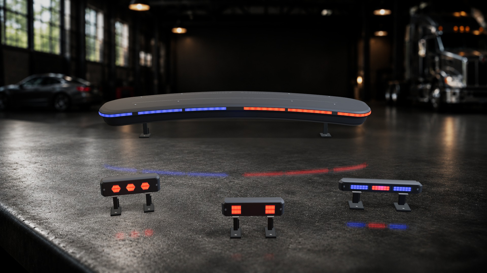
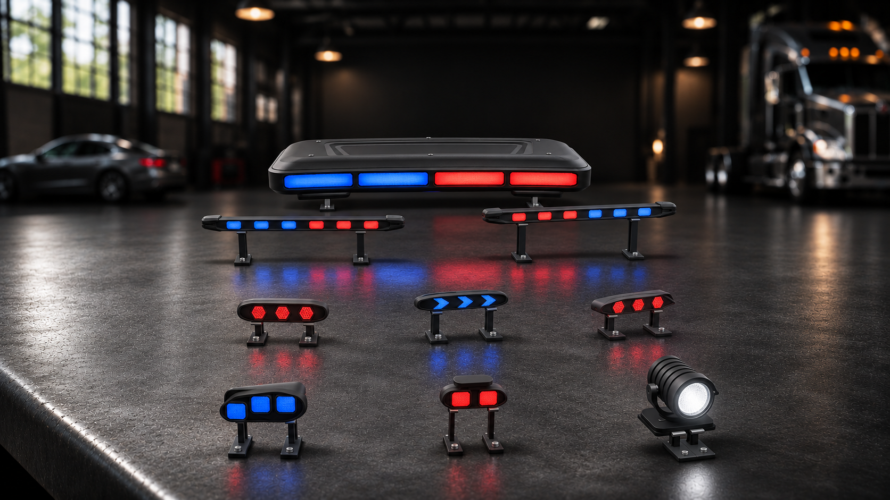
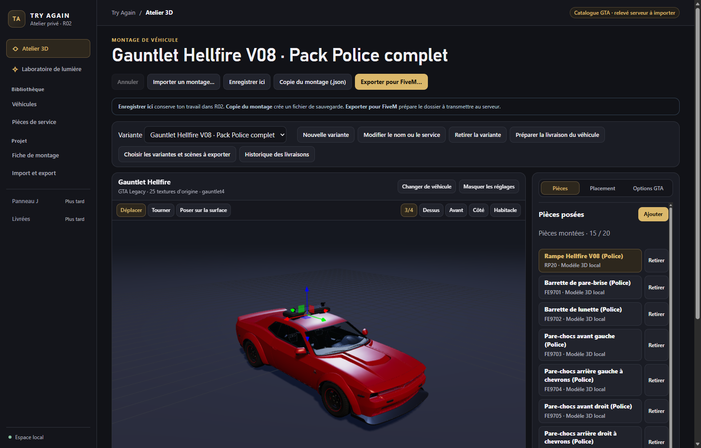

# Custom Emergency Light Kits

**Des feux d’urgence configurables pour FiveM, par Spino.** Monte des optiques, choisis une variante et pilote ses scènes lumineuses en jeu.

## Téléchargements

**CELK 0.3.3.1 (Interface)** · Préversion avec le Sadler Police et Remorqueur. FiveM rapporte 35 contrôles logiciels réussis. L’essai GTA du build Interface, le multijoueur et la performance sous charge restent à qualifier.

[Cœur 0.3.3.1](https://github.com/MrSpinoQc/custom-emergency-light-kits/releases/download/v0.3.3.1/CELK-script-0.3.3.1.zip) · [Préparateur 0.3.3.1](https://github.com/MrSpinoQc/custom-emergency-light-kits/releases/download/v0.3.3.1/CELK-preparateur-depot-0.3.3.1.zip) · [Ensemble Sadler V01](https://github.com/MrSpinoQc/custom-emergency-light-kits/releases/download/v0.3.3.1/sadler-jeu-v01-9bf8d35c.zip)

[Préversion et adaptateurs facultatifs](https://github.com/MrSpinoQc/custom-emergency-light-kits/releases/tag/v0.3.3.1) · [Installation](https://github.com/MrSpinoQc/custom-emergency-light-kits/blob/v0.3.3.1/versions/0.3.3.1/INSTALLATION.md) · [Empreintes](https://github.com/MrSpinoQc/custom-emergency-light-kits/blob/v0.3.3.1/versions/0.3.3.1/SHA256SUMS.txt)

### CELK 0.3.2 · Phantom, Airport Bus et Kuruma

[Cœur CELK 0.3.2](https://raw.githubusercontent.com/MrSpinoQc/custom-emergency-light-kits/fe8cc4ad9bca20a5a4a85b9fc696e6586799afeb/telechargements/CELK-script-0.3.2.zip) · [Préparateur de dépôt 0.3.2](https://raw.githubusercontent.com/MrSpinoQc/custom-emergency-light-kits/fe8cc4ad9bca20a5a4a85b9fc696e6586799afeb/telechargements/CELK-preparateur-depot-0.3.2.zip) · [Empreintes](versions/0.3.2/SHA256SUMS.txt) · [Préversion](https://github.com/MrSpinoQc/custom-emergency-light-kits/releases/tag/v0.3.2)

**Packs de jeu** · [Phantom](https://raw.githubusercontent.com/MrSpinoQc/custom-emergency-light-kits/2b67b717dab6486deb1744418c48c2448d11d50b/telechargements/ensemble-phantom-060a37bf.zip) · [Airport Bus](https://raw.githubusercontent.com/MrSpinoQc/custom-emergency-light-kits/2b67b717dab6486deb1744418c48c2448d11d50b/telechargements/ensemble-airbus-78be8891.zip) · [Kuruma](https://raw.githubusercontent.com/MrSpinoQc/custom-emergency-light-kits/2b67b717dab6486deb1744418c48c2448d11d50b/telechargements/ensemble-kuruma-41340f59.zip)

**Adaptateurs CELK facultatifs** · [Adaptateur Qbox pour CELK 0.3.2](https://raw.githubusercontent.com/MrSpinoQc/custom-emergency-light-kits/10031f68e337d1d560d97d6e95aa7d19c9e345b4/telechargements/CELK-adaptateur-Qbox-pour-0.3.2.zip) · [Adaptateur LVC pour CELK 0.3.2](https://raw.githubusercontent.com/MrSpinoQc/custom-emergency-light-kits/10031f68e337d1d560d97d6e95aa7d19c9e345b4/telechargements/CELK-adaptateur-LVC-pour-0.3.2.zip) · [Versions Qbox/LVC et repli](COMPATIBILITE.md)

Le cœur fonctionne en mode autonome. Ajoute Qbox pour la reprise des montages au garage, ou LVC pour raccorder les éclats et la sirène. [Quand utiliser les adaptateurs](COMPATIBILITE.md#adapter-celk-à-son-serveur)

Configure le dépôt une fois. Extrais ensuite les ensembles compatibles dans le dossier des packs, relance la préparation et redémarre le serveur avec la génération produite. [Guide d’installation](versions/0.3.2/INSTALLATION.md)

## Phantom Grand Format

Le montage Police pour le Phantom GTA comprend **14 pièces**, quatre types d’optiques et cinq scènes. [Ensemble Phantom pour CELK 0.3.2](https://raw.githubusercontent.com/MrSpinoQc/custom-emergency-light-kits/2b67b717dab6486deb1744418c48c2448d11d50b/telechargements/ensemble-phantom-060a37bf.zip). [Fiche du pack](PACKS.md#phantom-grand-format--010)

*Visuel de présentation des optiques conçues par Spino. La texture et la teinte du métal illustrent la scène.*

## Airport Bus et Kuruma

L’**Airport Bus Police V05** comporte 20 pièces et trois scènes. [Fiche Airport Bus](PACKS.md#airport-bus-police-v05)

La **Kuruma V05** propose **Police v2**, **Ambulance blanche** et **Mécano jaune** dans le même ensemble. [Voir les optiques et les vues sur la Kuruma](PACKS.md#galerie-kuruma)

## Suivi du projet

[Fonctionnalités et travaux prévus](FEATURES.md) · [Notes de version](CHANGELOG.md) · [Retours multijoueurs](https://github.com/MrSpinoQc/custom-emergency-light-kits/issues/1)

<strong>Soutenir le développement</strong>

Un **Patreon est envisagé** pour partager des nouvelles de développement plus régulières. La formule, le rythme et les éventuels avantages restent à définir. Tout projet d’accès payant à des packs ou à des téléchargements sera évalué selon les droits sur les fichiers et les règles de FiveM. Les annonces de versions sont publiées dans le suivi GitHub. [Conditions FiveM](https://fivem.net/terms) · [Documentation Cfx sur les ressources payantes](https://docs.fivem.net/docs/server-manual/finding-resources/)

Les conditions de partage et la licence de CELK restent à définir.

## Archives

[Parcourir les anciens ZIP et leurs guides](telechargements/archives/README.md).

- **CELK 0.3.1** · [Préversion et anciens téléchargements](https://github.com/MrSpinoQc/custom-emergency-light-kits/releases/tag/v0.3.1) · [Guide d’origine](versions/0.3.1/INSTALLATION.md)

- **Hellfire Police V08** · [Préversion 0.2.0-rc.2-hellfire.5](https://github.com/MrSpinoQc/custom-emergency-light-kits/releases/tag/v0.2.0-rc.2-hellfire.5) · [Guide d’origine](versions/0.2.0-rc.2-hellfire.5/INSTALLATION.md)
- **Phantom Grand Format Police** · [Préversion 0.2.0-rc.1](https://github.com/MrSpinoQc/custom-emergency-light-kits/releases/tag/v0.2.0-rc.1) · [Guide d’origine](versions/0.2.0-rc.1/INSTALLATION.md)

<strong>Hellfire Police V08 · galerie</strong>

Ce montage est présenté avec sa [préversion historique](https://github.com/MrSpinoQc/custom-emergency-light-kits/releases/tag/v0.2.0-rc.2-hellfire.5). Il réunit **15 pièces**, dont la rampe V08, les barrettes de vitre, les feux de flanc et deux projecteurs orientables. La scène **Double alternance** comporte 50 pistes. Pose, éclairage, visée des projecteurs et reprise du montage ont été vérifiés en GTA solo. [Fiche et aperçu de placement](PACKS.md#hellfire-police-v08)

*Optiques Hellfire conçues par Spino. Rendu des modèles 3D de production avec finition d’ambiance générative.* [Provenance du visuel](images/hellfire-police-v08-provenance.md)

*Vue de placement en trois quarts avant. Les 15 pièces, leurs poses et leurs réglages correspondent au montage distribué.* [Provenance de la capture](images/hellfire-police-v08-provenance.md#aperçu-de-placement-atelier-r02)

<strong>CELK 0.1.2 · Première revue publique Phantom</strong>

Cette paire historique utilise le script CELK 0.1.2 et Phantom Grand Format 0.1.0. [ZIP du script](https://raw.githubusercontent.com/MrSpinoQc/custom-emergency-light-kits/fe481d8760fc1e6d02f3d7010e2124ef164057c6/telechargements/CELK-script-0.1.2-candidat.zip) · [ZIP du pack Phantom](https://raw.githubusercontent.com/MrSpinoQc/custom-emergency-light-kits/3f5ba2aba6c66d9fecd1b63792cd6931f8e14f1c/telechargements/CELK-phantom-grand-format-0.1.0-revue-2.2.zip) · [Guide 0.1.2](versions/0.1.2/INSTALLATION.md) · [Empreintes d’origine](telechargements/archives/SHA256SUMS-0.1.2.txt) · [Code 0.1.2](celk_runtime)

