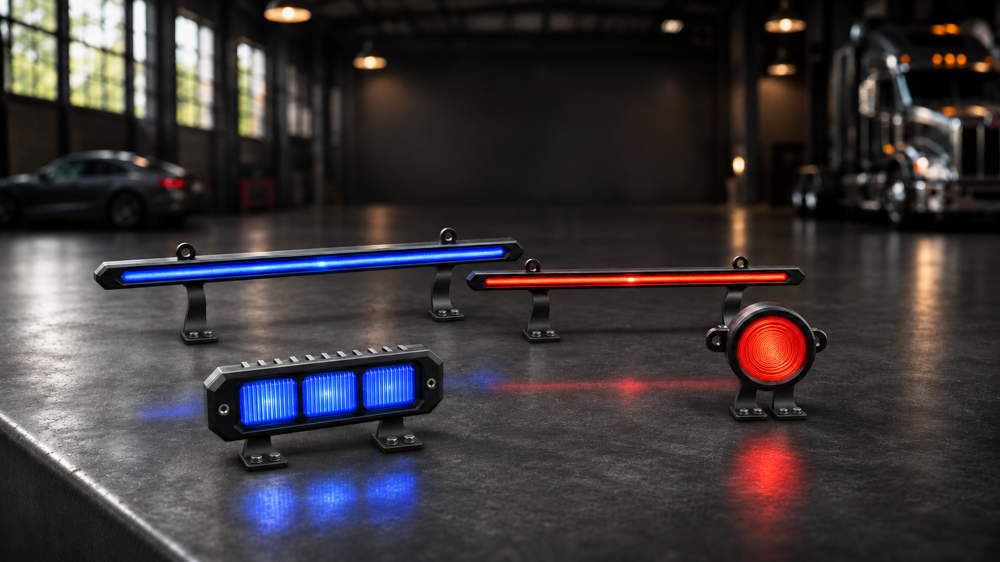

# Custom Emergency Light Kits

**Un projet de Spino pour FiveM.** CELK ajoute des optiques d’urgence, des montages et des séquences lumineuses à un véhicule déjà disponible sur le serveur. Cette première revue technique porte sur le **Phantom Grand Format, montage Police**.

> [!WARNING]
> ⚠️ ATTENTION — TRÈS IMPORTANT : démarrer les packs avant CELK
>
> Le script vérifie au démarrage que le pack Phantom est déjà actif. Inscris ces deux lignes dans cet ordre dans le fichier CFG chargé par FXServer.

```cfg
ensure celk_pack_phantom
ensure celk_runtime
```

## Téléchargements

Installe les deux archives ensemble et suis le guide de ce dépôt, qui décrit la procédure txAdmin de cette publication. Le pack fournit les optiques et leur montage. Le script gère la pose, les commandes et les effets.

| Archive | Version | Téléchargement |
| --- | --- | --- |
| Script CELK | 0.1.2 candidat | [ZIP du script](https://raw.githubusercontent.com/MrSpinoQc/custom-emergency-light-kits/main/telechargements/CELK-script-0.1.2-candidat.zip) |
| Pack Phantom Grand Format | 0.1.0, notice 2.2 | [ZIP du pack](https://raw.githubusercontent.com/MrSpinoQc/custom-emergency-light-kits/main/telechargements/CELK-phantom-grand-format-0.1.0-revue-2.2.zip) |

[Guide d’installation txAdmin et FiveM](INSTALLATION.md) · [Empreintes SHA-256](telechargements/SHA256SUMS.txt) · [Mises à jour et sauvegardes](MISES-A-JOUR.md) · [Catalogue](PACKS.md) · [Notes de version](CHANGELOG.md)

## Contenu de cette version

- Montage Police à 14 accessoires et cinq scènes pour le Phantom GTA d’origine (`phantom`). Le véhicule est fourni par le jeu.
- Sélection du montage avec **F6**, des scènes avec **J** et des éclats avec **Q**, selon les permissions FiveM. Le montage peut être conservé sous un identifiant durable de véhicule.
- **Compatibilité limitée au Phantom Police.** Le script 0.1.2 attend `celk_pack_phantom` en version 0.1.0 et son inventaire précis. La prise en charge d’un autre pack ou véhicule demandera une évolution du script.

Les essais existants couvrent le démarrage sur FXServer Windows, une migration témoin, le retour arrière et des essais dans GTA en solo à 14 et 20 accessoires. **La synchronisation à deux clients reste non validée. Cet essai est différé sans échéance.**

## Code et revue

Le [code du script](celk_runtime) est consultable directement. Pour suivre le démarrage et l’activation d’un montage, voir le [manifeste](celk_runtime/fxmanifest.lua), le [point d’entrée serveur](celk_runtime/server/main.js), le [chargement du pack](celk_runtime/server/packs.js) et l’[activation](celk_runtime/server/activation.js).

Pour signaler un problème, indique les versions du script, du pack et de FiveM, le véhicule et le montage, les étapes et le message obtenu. Retire les clés et les données de joueurs des extraits de journaux.

Les conditions de partage et la licence restent à définir.

## Phantom Grand Format

Phantom Grand Format est le premier kit présenté. Il comprend quatre types d’optiques, conçues pour la calandre, le pare-chocs, le pare-brise et les marchepieds.



*Visuel de présentation des optiques conçues par Spino. La texture et la teinte du métal illustrent la scène.*
